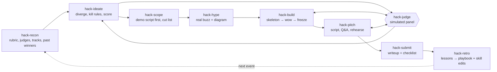
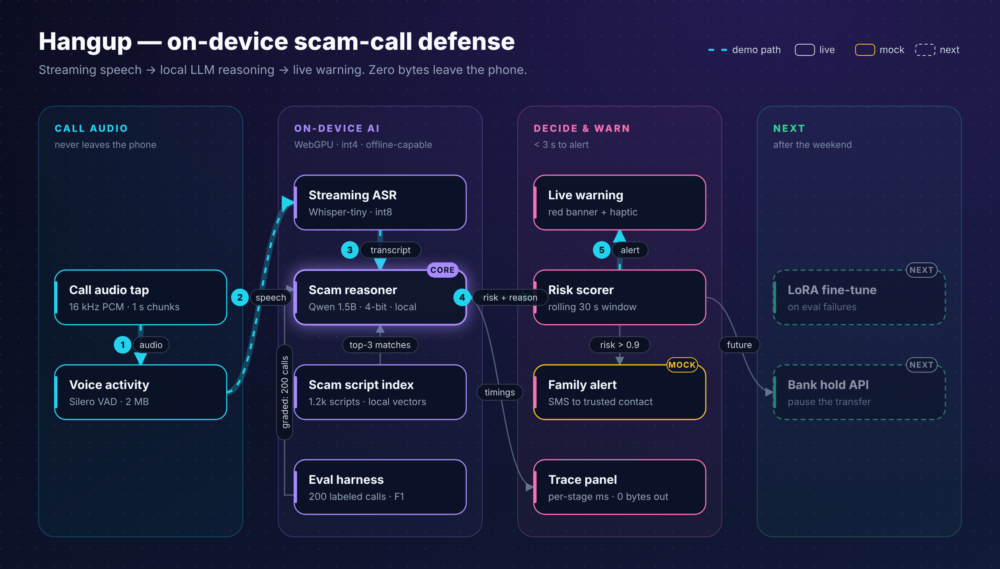

# hack-hackathon

A pipeline of Claude Code skills for winning hackathons. Each skill handles one stage, passes state to the next through a `.hackathon/` folder in your project, and a retro loop feeds evidence back into the playbook and skills after every event.

The design premise: **you're scored by tired judges against a rubric in a 3–5 minute demo.** Optimize for that, not for the best codebase.



`/hack` is the orchestrator: it tracks the clock against a phase budget, tells you when you're behind, and routes to the next stage.

## Install

```bash
git clone https://github.com/ZelinZhu-Richard/hack-hackathon.git
cd hack-hackathon && ./scripts/install.sh
```

This symlinks each skill into `~/.claude/skills/` and the repo to `~/.claude/hack-hackathon`, so the skills work in any project and retro edits land back in this repo.

## Use

In your hackathon project directory:

```
/hack
```

Or call any stage directly (`/hack-ideate`, `/hack-judge`, ...).

## Layout

| Path | Purpose |
|---|---|
| `skills/hack` | Orchestrator: setup, phase budget, routing |
| `skills/hack-recon` | Research rules, rubric, judges, sponsor tracks, past winners |
| `skills/hack-ideate` | Generate → kill → score → pick, against the rubric |
| `skills/hack-judge` | Independent simulated judges (subagents) to red-team ideas, builds, pitches |
| `skills/hack-scope` | Demo-script-first plan, real-vs-fake components, checkpoints, cut list |
| `skills/hack-hype` | Buzz audit (real trendy tech, scored by judge signal per hour) + animated architecture diagram |
| `skills/hack-build` | Build rules, checkpoint reviews, feature freeze |
| `skills/hack-pitch` | Timed script mapped to rubric, Q&A bank, rehearsal loop |
| `skills/hack-submit` | Devpost writeup, README, pre-submit checklist |
| `skills/hack-retro` | Post-event lessons; edits the skills themselves |
| `scripts/archgraph.py` | JSON spec → animated dark-theme architecture SVG (stdlib only; refuses unmeasured metrics) |
| `scripts/svg2png.js` | SVG → 2× PNG via Playwright |
| `playbook/principles.md` | Generic priors on what wins |
| `playbook/lessons.md` | Your own evidence; overrides principles |
| `playbook/profile.md` | Who is competing (solo, first-timer, strengths); its rules override stage defaults |
| `examples/pennapps-xxvii/` | Worked example: real recon + state for PennApps XXVII (Feb 2027) |

## Example diagram (hack-hype trial on a PennApps idea)



## Per-project state (`.hackathon/`)

`state.md` (clock, phase, decisions) · `recon.md` · `idea.md` · `judging.md` · `plan.md` · `build-log.md` · `pitch.md` · `submission.md`
